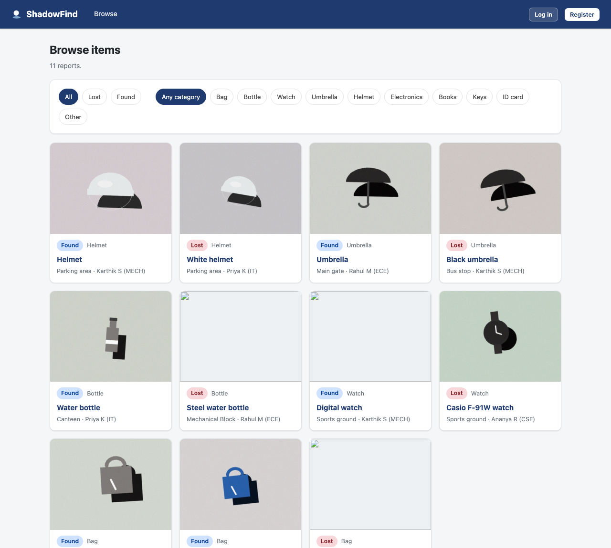
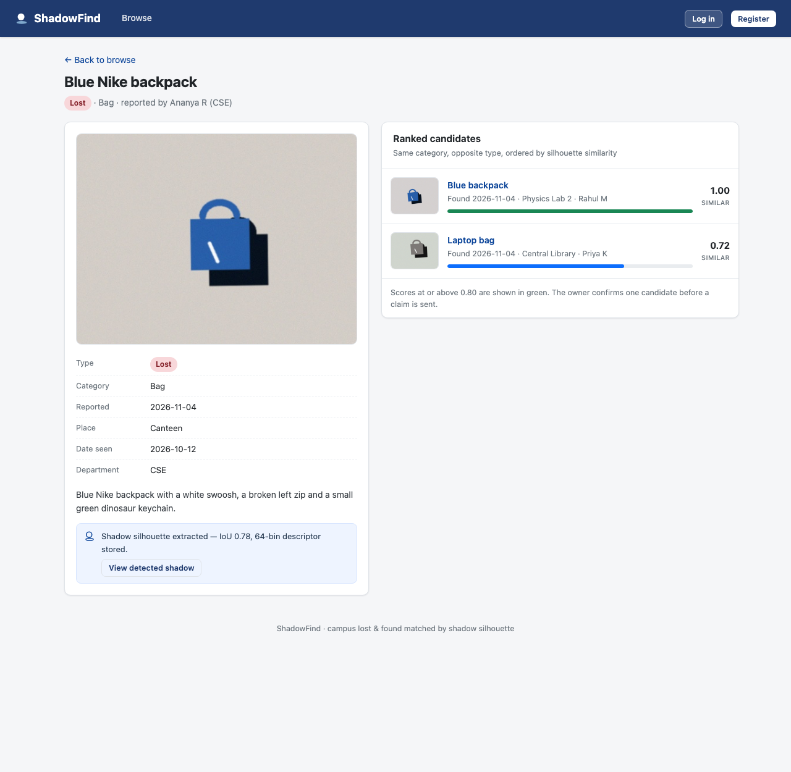

# ShadowFind

**A campus lost-and-found app that matches items by the shape of their cast shadow, not by text descriptions.**

Photograph a lost or found item once. ShadowFind isolates the item's cast shadow with OpenCV, reduces the silhouette to a 64-value descriptor, and ranks the reports that look like it. A blue bag is compared with another blue bag by outline — not by two people's descriptions of it.



---

## Live demo

### ▶ https://sachin0496.github.io/shadowfind-lost-found/

The site runs the whole app in your browser: OpenCV.js does the shadow extraction
and `localStorage` holds the accounts and reports. Log in with
`ananya@college.edu` / `shadow123` (or any account listed on the login page) and
try reporting an item with your own photo.

GitHub Pages can only serve static files, so this is a JavaScript port of the
same pipeline (`docs/assets/vision.js`), not the Flask app. Both builds produce
the identical 64-value descriptor, which is why the seeded rankings match.


---

## Quick start

```bash
git clone https://github.com/Sachin0496/shadowfind-lost-found.git
cd shadowfind-lost-found

python3 -m venv .venv && source .venv/bin/activate
pip install -r app/requirements.txt

python app/seed.py       # demo accounts + 11 sample reports
cd app && python app.py  # http://127.0.0.1:5000
```

Log in with any demo account (`ananya@college.edu`, `rahul@college.edu`, `priya@college.edu`, `karthik@college.edu`) — password **`shadow123`**.

Or with Docker:

```bash
docker build -t shadowfind . && docker run -p 8000:8000 shadowfind
```

---

## How the matching works

```
photo ──► greyscale + blur ──► adaptive threshold ──► largest blob ──► fill holes
                                                          │
                                        normalise to 64×64 │
                                                          ▼
                              8×8 occupancy grid  +  aspect ratio & solidity
                                                          │
                                           64-value descriptor, L2-normalised
                                                          ▼
                                     cosine similarity ──► ranked candidates
```

The descriptor lives in `app/vision.py` and has no web dependencies, so it can be tested and benchmarked on its own:

```bash
python -c "
import sys; sys.path.insert(0, 'app')
import vision
a = vision.extract_shadow(vision.make_sample('blue', 'bag', seed=1))
b = vision.extract_shadow(vision.make_sample('blue', 'bag', seed=2))
print('same item, two photos:', round(vision.similarity(a.descriptor, b.descriptor), 3))
"
```

Why a grid rather than a radial histogram: an early version used 64 angular bins, but that threw away position, so a watch and a bag scored 0.97 against each other. The occupancy grid keeps *where* the mass sits; the outer ring of mostly-empty cells now carries aspect ratio and solidity.

---

## The app

| Route | What it does |
|---|---|
| `/` | Landing page with live counts and recent reports |
| `/register`, `/login` | Hashed passwords (`werkzeug.security`), server-side validation |
| `/dashboard` | Your reports and incoming claims |
| `/report` | Upload an item; the shadow is extracted on submit |
| `/browse` | Every report, filtered by type and category |
| `/item/<id>` | The item, its detected shadow, and its ranked candidates |
| `/claim/<lost>/<found>` | Send a claim request |
| `/claims` | Accept, reject, or confirm a handover |



Status flows `pending → accepted → returned`, with `rejected` reachable from pending. Accepting one claim on a match automatically rejects the others.

**Security:** parameterised SQL everywhere, `generate_password_hash`/`check_password_hash`, session checks on every protected route, uploads validated by decoding them with OpenCV (not by trusting the extension), 6 MB cap, and generated filenames.

---

## Tests

```bash
pip install -r requirements-dev.txt
python -m pytest tests -q     # 21 passed
```

Covers the pipeline (descriptor length, unit norm, bounded similarity, ranking order, blank/empty input) and the routes (auth guards, upload → descriptor stored, the full claim flow, self-claim rejection, and that a wiped data directory is recreated rather than 500ing).

---

## The report

`ShadowFind_Report.pdf` is a 23-page mini-project report written to the KPR Institute format, and the pipeline that generates it is in the repo root (`content.py`, `paginate.py`, `render_pdf.py`, `make_figures.py`). `./make.sh` regenerates it.

> **Note on the report:** it was written before the app existed, so its figures (79% top-1 over 96 labelled pairs, a 24-participant survey, the accuracy tables) are **illustrative — not measurements of this implementation**. The app is what the report describes, built afterwards. If you need the report's numbers to be real, they should be measured against the app and the tables rewritten.

---

## Layout

```
app/
  app.py          Flask routes, uploads, sessions
  vision.py       shadow extraction + descriptor + matcher
  db.py           SQLite schema and queries
  seed.py         demo accounts and sample reports
  templates/      Jinja2 pages
  static/         stylesheet
tests/            pytest suite
docs/             screenshots
ShadowFind_Report.pdf
content.py, paginate.py, render_pdf.py, make_figures.py, make_chart.py, build_report.py
```

Demo photos are rendered by `vision.make_sample()`, which draws simple objects with a cast shadow at randomised position, scale and rotation — so the two photos of a given item are genuinely different frames rather than identical renders.

## Limitations

- Matching is shadow-only. Objects with similar outlines but different colours (a bag and a helmet, say) can score highly; colour is deliberately ignored.
- Weak or absent shadows degrade the descriptor, which is why the report discusses a colour fallback.
- SQLite and local file storage: fine for a campus demo, not for concurrent scale.
- There is no CSRF token on the forms yet; add Flask-WTF before exposing this publicly.
